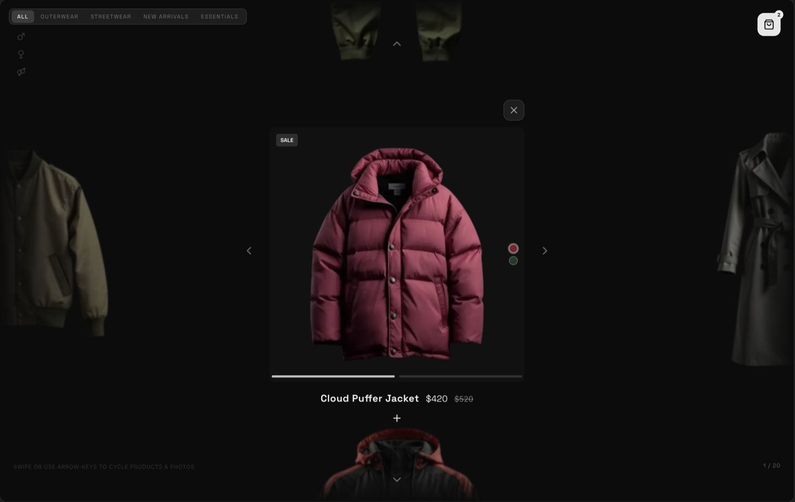
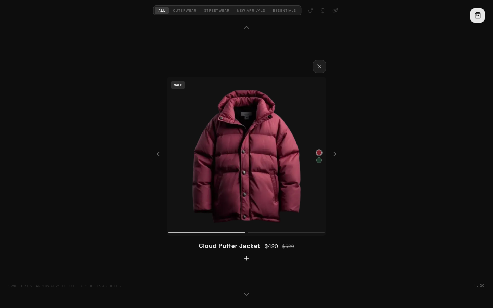
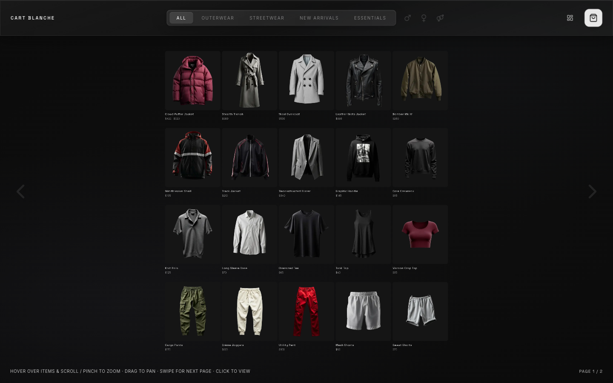
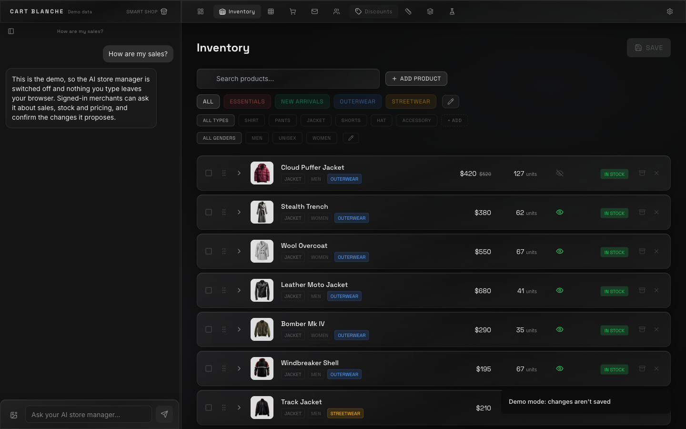
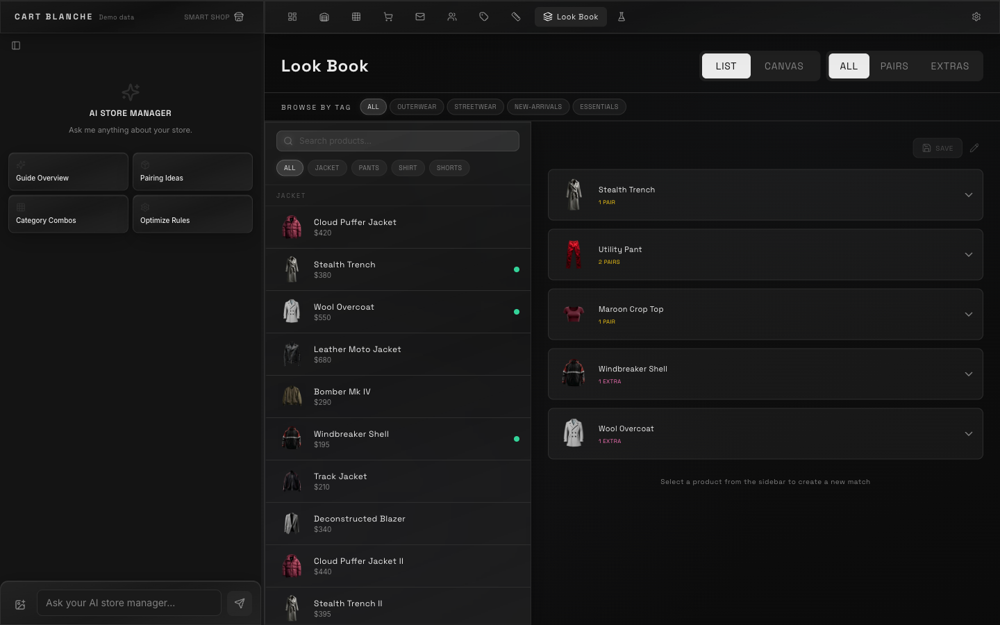

# How Cart Blanche got built

My words are quoted as I wrote or said them, typos fixed, nothing else. Commit hashes are from this repo. "Private note" means a dated chat or call record I keep offline.

## 1. The short version

In February 2026 the owners of a real fashion brand told me what running a serious Shopify store actually takes. On February 17 I had a PDF and no code. On February 18 Lovable made 417 commits for me and I presented a first version to those same owners.

Over the next three months it grew into a spatial storefront with two templates, a pairing canvas and a merchant portal, in 2,164 Lovable commits, with most of them landing on a handful of huge days. A technical collaborator came on to plan production and mobile. On November 1 it got a logged-out demo, a security pass and an MIT license, and it left Lovable for good. It's now a clone developed only in Claude Code, and readers bring their own Supabase and AI key.

This repo is the public prototype. I continued this project privately for a series of boutique fashion brands and wired it for their specific stores. Rather than an open system, Cart Blanche has chosen to be a "selects" platform: invite only, for premier boutique fashion brands.

## 2. Origin, in my words

On what the brand owners told me (call, February 26, 2026):

> "They have somebody that's like overseas running their store. And without that person, and they've been doing this process for twelve years, they're still jumping through hoops even as domain experts."

(call, February 20, 2026):

> "You have to hire a Shopify store manager and you can't even do it by yourself. Like, that's ridiculous to me."

On Shopify's AI, reacting to a post about it (private note, February 25):

> "I kinda disagree since their AI sucks."

Where I started (private note, February 17):

> "OK so I have this project I'm trying to build. I think I'll probably use Lovable to build it. I need to figure out everything that goes into it and how to break it down piece by piece in order to build it all completely proper."

And the order of attack, same day:

> "I really want to start with the smart shop and make the admin portal along with that. (I don't mean the admin as in me who's building the website, I mean the admin as in the person who's running the store.)"

The use case: the owners of a real fashion brand explained the problem and gave me the seed of the idea, a store you browse the way you scroll.

## 3. Timeline

| Date (2026) | What happened | Evidence |
|---|---|---|
| Feb 17 | "Just the doc, haven't started building." Full breakdown, smart shop and admin first | Private note |
| Feb 18 | 417 commits: flat grid, cart, chat sidebar, Style Kit, liquid glass, product media uploads, grid editor. First demo to the brand owners | `c0e13ba`, `2067763`, `14e410f`, `90b8150`, private note |
| Feb 19 | Grid editor connected to the storefront, Lab sandbox pages. Roadmap talks start | `fd06456`, `6ed33ee`, private notes |
| Feb 20 | Product shaping docs and the AI style assistant spec | `SmartCart_AI_Style_Assistant_Spec.md` |
| Feb 26 to 28 | Demo and database products merged, tag deletion | `d38ecdd`, `5df7219` |
| Mar 1 | This repo created from a remix. Product images regenerated, some pulled | `cc023b8`, `9be8ed4` |
| Mar 2 | Biggest day: 561 commits. Two templates, per-template themes, node canvas for the Style Guide, pairing tests | `fc41a97`, `054142f`, `4c2cb28` |
| Mar 3 | 207 commits. Configured matches, auto-arrange, thumbnails | `63a8dcb`, `57a498d` |
| Mar 4 | Demo for family. Notes on sizes, colors, zoom | Private note |
| March | Tester feedback collected into a master action list | Tracker doc |
| Apr 6 to 7 | Detail view fixes, pointer-based inventory drag, page breaks | `ad489c7`, `ee8c6e5`, `bee8d44` |
| Apr 26 | Remaining feedback verified against a build | Remaining-items doc |
| Apr 27 | Size chart editor, centered grid | Status note, `a002501` |
| May 1 | Gender toggle, waitlist table, 11 demo edits | `802c810`, `8629703`, `3c2231d` |
| May 2 | 327 commits. Waitlist page, subscriber capture, colorways, drag reorder, Build a Set fix | `c2b479c`, `d1987ca`, `0b5cdbe` |
| May 3 | Look Book audit, test suite 144 of 144. Active work is down to the AI Stylist | Status note |
| May 4 | Auth gate removed | `93138d3` |
| May 21 | Sidebar hover zones. Last Lovable commit | `3706a83` |
| Nov 1 | Email-link sign-in, logged-out demo admin, security migration, storefront scoping, hardened chat functions, MIT | `49d622b`, `e20777a`, `482ae68`, `75940df`, `ef7f16f`, `05848b8` |
| Nov 1 | Leaves Lovable: a clone developed only in Claude Code, with readers bringing their own Supabase and AI key. Runs with no backend, any OpenAI-compatible provider, `SETUP.md` | `0fe3198`, `756571a`, `1dbc52d`, `99481a5` |
| Nov 1 | Advisories, images, types and lint: no high or critical audit issues, real WebP files, chat functions type-check, lint errors from 116 to 0 | `920d7b1`, `1449e6a`, `c7c95bc`, `6af6d32` |
| Nov 1 | Shopper signups and photos through rate limited functions, discount checks rate limited, merchant accounts invitation only | `fe19888`, `43b1f33`, `74cae19`, `6b31fea` |
| Nov 1 | Real-store fixes: no sample catalogue on a real store, stylist on the store's own products, no invented orders, blank slugs. Phone admin, responses on Checkout and Connect Stripe, a details panel that stopped flapping | `cac1ec2`, `296d08e`, `f2af4e7`, `165ba35`, `ebd12fd`, `3c8b504`, `1444ecc` |

History shape: February 495 commits, March 933, April 157, May 579. Three days hold more than half of it: March 2, February 18, May 2.

## 4. Round by round

### Round 1: a storefront in a day (February 17 to 19)
- **Built:** the flat grid, the zoom, the cart, the first admin and a grid editor.
- **Tested:** shown to the brand owners on February 18, and to another contact the next day.
- **Broke:** mostly look and feel. The day's commits are small corrections to labels, glass and headers.
- **Wanted next:** the whole platform on paper, which meant days of product shaping and a master doc.

### Round 2: templates and pairing (March 1 to 6)
- **Built:** two storefront looks, YZ and SL, per-template themes, a node canvas for what pairs with what, Build a Set, regenerated product images.
- **Tested:** a pairing logic test suite, a demo for family, and tester walkthroughs.
- **Broke:** theme leaked between admin and storefront (`fc41a97`, plus a dedicated fix prompt). Images came back wrong repeatedly, so batches got re-ingested (`4e9440f`, `2ec554e`). The repo got too big to upload as a zip.
- **Fixed:** theme isolation. Template fixes were done by writing precise prompts for Lovable.
- **Wanted next:** real feedback, turned into a list.

### Round 3: feedback pass (March to April)
- **Built:** the master action list. Detail view peeks, arrows, responsive fixes, swipe logic, inventory drag.
- **Tested:** every item checked against a build. On April 26 the status tracker still held 1 item conservatively marked done and 61 unverified, and a second pass verified which were really open.
- **Broke:** detail view clipped add-to-cart on some window sizes (`ad489c7`), vertical swipe blocked (`213b14f`), and the SL swipe bounce stayed unresolved as of that list.
- **Wanted next:** what a real merchant needs on the back end.

### Round 4: the portal grows up (April 27 to May 4)
- **Built:** size chart editor, gender data, waitlists by size, subscriber capture with CSV, colorways, Look Book filtering.
- **Tested:** the suite at 144 of 144. The May note credits that number to the pairing file, but today that file has 16 tests and 127 belong to the template agent, so 144 reads as the whole suite.
- **Broke:** inventory save, colorway ids in variants (`d1ae07d`), Look Book node logic (5 bugs in one audit).
- **Fixed:** those.
- **Wanted next:** the AI Stylist. Called "one last leg", it was really six sub-arcs. It wasn't finished that May.

### Round 5: open it up (November 1)
- **Built:** a logged-out demo admin on an in-memory client, email-link sign-in, an MIT license. Lovable is the true start of this codebase, but development moved here: it's a clone worked on only in Claude Code, and anyone who wants the backend brings their own Supabase and AI key.
- **Tested:** see section 6.
- **Broke, found in the audit:** storefront data wasn't scoped to one merchant (`75940df`), protected store columns were writable (fixed with triggers), chat functions needed limits (`ef7f16f`). Long shopper chats would hit the new cap, so history got trimmed (`6121188`).

### Round 6: make it stand on its own (November 1)
- **Built:** a backend-free default, provider-neutral AI keys and a setup guide, then functions for what logged-out shoppers do, so they never get direct write access.
- **Tested:** a real local Supabase stack, the suite and the browser. See section 6.
- **Broke:** on that real stack every table failed with permission denied, because new Supabase projects no longer expose new tables by default (`2f10bb2`). A real store also sold the sample catalogue and could only get recommendations from it (`cac1ec2`, `296d08e`), and a store with no orders saw 100 invented ones (`f2af4e7`). Oversized photos hung the client (`5fc90bd`), and the product details looped open and shut under the cursor (`1444ecc`).
- **Fixed:** all of those, and every lint error, with no rules turned off (`6af6d32`).

## 5. Feature family tree

```
"Shopify needs a full-time operator"
├─ spatial storefront → grid editor → two templates (YZ, SL) → per-template themes
│  └─ Lab sandbox → template builder agent (rule-based, with its own tests)
├─ admin portal → inventory → size charts → waitlist by size → subscriber capture
│  └─ AI store manager (propose, then confirm)
├─ cart → AI style assistant → SmartCart chat → stylist on the store's own products
└─ "complete the look" → Style Guide canvas → pairing logic → Build a Set → Look Book
reviewers can't log in → demo client → all admin routes work logged out
real store → sample catalogue leaks found → samples kept to the demo
leaving Lovable → Claude Code only → bring your own Supabase and AI key → SETUP.md
```

## 6. Test log

| When | What | Result | Where |
|---|---|---|---|
| Spring | Template agent suite | 127 tests, still in the count below | Project hub note, `template-agent.test.ts` |
| May 3 | Whole suite | 144 of 144 | Status note |
| Nov 1, before the backend-free work | Vitest | 202 of 202 | Rerun while writing this |
| Nov 1, tip `9eb1fb2` | Vitest, unit and component tests | 281 of 281 in 23 files: template agent 127, chat guards 31, shopper guards 18, pairing 16, demo store 14, the rest smaller | Run while writing this |
| Nov 1, tip `9eb1fb2` | Lint, typecheck, build | Lint 0 errors, 45 warnings. `tsc` clean. Build passes | Run while writing this |
| Nov 1, tip `9eb1fb2` | `npm audit --omit=dev` | No high or critical, 5 moderate | Run while writing this |
| Nov 1, fresh clone of `192ef8e` | `npm ci`, lint, build, tests | All pass, 281 tests | Run while writing this |
| Nov 1 | Real local Supabase stack | Showed every table failing with permission denied, fixed with explicit grants | `2f10bb2` |
| Nov 1 | Security fixes on that stack, with real sign-in tokens and a fake AI provider | Storage ownership and limits, closed reads on merchants and discount codes, locked fee and Stripe columns, shopper functions and their limits, merchant signups closed, a real magic link through the local mail catcher, then signed-in writes confirmed in Postgres | Session scripts, not in this repo |
| Nov 1 | Browser, on that stack and on the no-backend build | Storefront, all 11 admin routes, and a logged-out shopper's subscribe, waitlist, cart code, stylist and photo upload | Session scripts, not in this repo |
| Nov 1 | `SETUP.md`, local path | Ran end to end from a fresh clone at `6243771` | Session notes |
| Nov 1 | `deno check` on all 4 functions | Pass | Session notes, `c7c95bc` |
| Nov 1 | 25 migrations on embedded Postgres with stubs | 42 role checks pass | Audit report |
| Nov 1 | Edge functions, outbound stubbed | 16 `smartcart-chat`, 15 `smart-chat` checks pass | Audit report |
| Nov 1 | Browser sweep, dev and production | No writes, no other Supabase requests. One dev-only console error, fixed in `3c8b504` | Audit report |
| Nov 1 | Demo clicks | Discount create and delete, waitlist, order status, inventory, add product, cart promo rules all behave | Audit report |

## 7. Roads not taken

- **Starting with SmartCart and cross-store intelligence.** Held off on day one for smart shop and admin first.
- **Matching Shopify feature for feature.** The competitive teardown argued against it.
- **Picking one default template.** Decided May 2: it depends on the audience.
- **One exclusive payment processor.** Decided May 2: bring your own.
- **Loosening the database for reviewers.** The demo runs on an in-memory client instead.
- **Passwords.** Gone. Email link only.
- **Staying on Lovable.** The clone moved to bring-your-own instead.

## 8. Where it went

I continued this project privately for a series of boutique fashion brands and wired it for their specific stores. Rather than an open system, Cart Blanche has chosen to be a "selects" platform: invite only, for premier boutique fashion brands.

## 9. Before and after visuals

May 3, on my screen in the Lovable editor (cropped):



November 1, the same jacket on the current build:



The storefront grid, November 1:



The store portal in demo mode, November 1:



The Look Book, November 1:



Product photos and the logo aren't covered by the MIT license.

## 10. My method

1. **Start with the doc.** Break the thing into every piece before writing a prompt.
2. **Pick the slice that proves it.** Storefront and admin first. Everything clever waits.
3. **Show it the next day.** The first demo came within 24 hours of the first commit.
4. **Turn feedback into a tracked list, then verify against the build.** Don't trust "done".
5. **Fix by prompt, precisely.** When Lovable breaks something, write what it may and may not touch.

## 11. Sources

- Commits: `git log` of `fidgetcoding/cart-blanche-main`.
- Code: `src/lib/demo/`, `src/lib/pairing-logic.ts`, `src/pages/admin/`, `supabase/migrations/`, `supabase/functions/`. Setup: `SETUP.md`.
- Private, kept by me: chat and call records dated February 17 to May 3, 2026. Status note, May 3. Tracker docs, March and April 26. `SmartCart_AI_Style_Assistant_Spec.md`. `shopify-competitive-analysis.md`.
- Audit report, November 1, 2026 (session notes), plus runs made while writing this.
